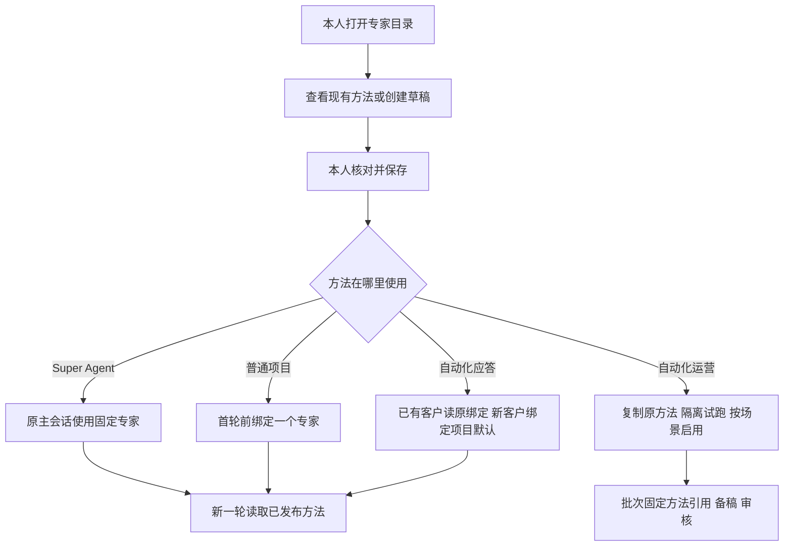

# 专家目录与调用 PRD

用户在「专家」管理方法，在实际消费入口决定使用哪个方法。专家身份、执行所用版本和业务授权各有明确来源。管理目录直接读取现有方法，普通对话沿用 Harness Session，批量备稿沿用现有 Worker 和 Temporal。

目录验收覆盖前次正式版读回的四个内置 Skill、「私域运营」和「黄小璨企微客服」两个项目 Skill，以及原中心的六个批量方法。构建候选前以当时正式版重新对账。

## 业务判断流程

## 保留的能力与最小改动

| 用户需要 | 现有机制 | 最小改动 |
| --- | --- | --- |
| 在一个地方找到并维护方法 | 官方 Skill 发现器、本人 Markdown 编辑、运营方法资源 | 「专家」页合并显示来源、用途、正文、参考文件和使用位置。原选择入口链接同一详情。用稳定的所属范围和源键标识，同名专家按所属范围区分。 |
| 自己写或生成方法 | Super Agent 对话、标准 Skill 文件、现有编辑弹窗 | 新建时可手写，也可在 Super Agent 起草后贴进同一表单。本人维护名称、用途、正文和 Markdown 参考文件，再校验保存。首版去掉独立生成接口、草稿后台和版本管理页面。 |
| 让会话始终使用选定专家 | 原生 Session、工作台 Preset 和官方 Skill 加载 | 首次写入专家引用，后续同一 Session 只解析该引用。原生预设仍承担角色、模型和工具装配。 |
| 维护运营原方法的工作台版 | 已发布方法快照、`MethodRefs`、原批次审核和回执 | 同页复制原方法、改正文、隔离试跑并启用指定版本。运营存储继续使用现有 `Method` 记录。 |

Harness 的 Preset 装配 Agent，Skill 目录按工作区和会话作用域发现方法，正文可由原生工具加载。工作台沿用这些接口实现单专家约束。交互沿用 Product Design 对现有截图确定的「列表 → 详情」「新会话 → 选择」两条路径，复用现有 Cordis 组件。[Harness Skill 机制](https://github.com/deepseek-ai/deepseek-harness/blob/master/docs/subsystems/skills.zh.md) · [Agent Skills 规范](https://agentskills.io/specification)

## 绑定和保存规则

- **Super Agent** 的目录项固定指向原主会话的 `AGENT.md`，复用当前本人 Markdown 读写和修订检查。保留现有运行提示中的授权与确认约束，省掉第二份个人专家包。既有 `SOUL.md` 继续由原设置处理。
- **普通会话** 在首轮运行前一次性写入绑定。新会话可选当前项目可用的专家，优先使用项目默认。有唯一业务专家时可预选，无业务专家时用现有通用助理行为。有多个候选且缺默认时要求明确选择，自动派发回报目标项目缺默认。旧会话缺绑定时在下次启动按同样规则完成首次绑定。换专家创建新 Session。宿主按绑定限定原生 Skill 的发现和加载，两条调用路径 `/skill-name` 与 `skill({name})` 读取同一限制。
- **自动化应答** 将「新会话默认专家」保存到既有项目配置存储的独立设置项。单改默认值不推进现有发送门禁使用的应答配置修订。先按可追溯的原入站专家或切换前项目配置补齐既有客户会话，再开放默认值切换。新客户首次归属时事务内固定专家；已有入站、准备发送和未知结果按原记录续办。原接管、停答及资料撤权检查继续生效。
- **保存和生效** 校验专家归属、方法内容与旧修订，验证通过后原子发布。原发行包里的项目专家可以由本人保存同一身份的可编辑副本，副本放在发布还原范围之外。发布失败沿用旧版。新轮次读取同一专家的最新成功版本，开始时固定实际内容或可回查引用。后续模型步骤和同一轮恢复复用该版本。更名仅改展示名。方法引用不赋予项目额外资料或工具权限。
- **自动化运营** 在现有备稿流程中复用原 `skill_key` 和输出合同。试跑通过后，在现有运营设置按策略键和 `skill_key` 启用已发布方法。由可信批次入口把原中心引用和工作台引用固化到原批次检查点，每页生成、重试和入审都对同一份记录核对。历史批次沿用原输入。固定模板继续由现有程序渲染，编辑生成说明只影响实际调用模型的条目。

## 对抗性验收

| 反例 | 通过条件 |
| --- | --- |
| 两个项目都有同名专家，或者请求伪造专家 ID | 管理页标出来源。Session 只能加载原绑定且本项目可用的方法。客户消息、模型和浏览器直调都无法改绑。 |
| 两个首轮请求并发选择不同专家，或者旧会话重启 | 只产生一个有效绑定。另一个请求返回冲突并读回实际绑定。会话历史和项目归属可以接续。 |
| 保存中断、并发覆盖或运行到一半发布新版 | 编辑冲突可见，发布失败仍可读旧版。在途轮次使用原版本，新轮次可读新版本。引用失效时报告实际原因，客户走既有人工接管。 |
| 应答默认从 A 切到 B 时，老客户已排队 | 老客户继续用 A，队列可推进，新客户用 B。停答或撤权仍能拦住旧稿。 |
| 运营试跑后未启用、已启用后重新同步原中心、生成中途重试或开始入审 | 未启用时执行原方法，启用只影响新批次和指定场景。同步不覆盖工作台引用，原批次按其固定方法入审并恢复。固定模板继续通过原输出校验。 |
| 旧版回滚会忽略客户绑定 | 用隔离回归证明旧版兼容，或在回滚前通过现有开关暂停受影响的自动应答，恢复到兼容版本后再启用。 |

交付顺序为专家目录与详情、普通会话和 Super Agent 绑定、应答新旧客户绑定、运营副本试跑与启用。每段用实际消费者验证，最终核对真实 Harness 工具输入与隔离回执。设计阶段已用现有代码和测试检查原会话恢复、批量方法选择与固定输出。上述新增行为需在实现后逐项验收。
