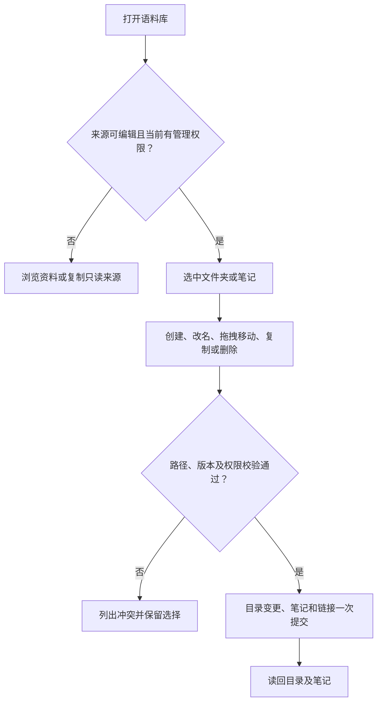

# 语料库与 Obsidian 能力对照

核对日期 2026-11-12。正式版 `native-20261112-41-vault-edit`，源码 `09fe063beb95d0c2bfc2a0d3b0060930d59292da`。核对了正式安装文件的摘要、已认证的只读接口、对应源码与 Obsidian 官方文档。线上读回了 137 篇原中心语料、5 篇原版答疑资料及 1 个原生可编辑库。原中心的目录深度为 3 层。8 项 Markdown 测试通过，并用合成笔记复核了嵌入、属性、图片和特殊语法的渲染结果。本机锁定且内置浏览器不可用，本次没有重新截图或在正式库试写。

## 文件和文件夹

| 能力 | 状态 | 工作台实况 |
| --- | --- | --- |
| 新建语料库 | 有 | 填名称创建空库，随后打开。 |
| 修改语料库名称和描述 | 有 | 知识库列表的「编辑」。 |
| 删除、归档整个语料库 | 缺 | 语料库列表没有对应操作。 |
| 多级目录与逐个展开、折叠 | 有 | 按笔记相对路径构建树。目录必须有笔记或有包含笔记的后代。 |
| 新建空文件夹、空子文件夹 | 缺 | 文件夹没有独立记录，移走最后一篇笔记后目录从树上消失。 |
| 文件夹改名、移动、删除 | 缺 | 文件夹行只有展开与折叠。 |
| 新建单篇笔记，包括空笔记 | 有 | 「新建笔记」接受名称，保存为 `.md`。 |
| 在指定文件夹内新建笔记 | 部分 | 可以填 `客户/服务/跟进`，保存后得到 `客户/服务/跟进.md`。文件夹行没有「在此新建」。 |
| 编辑、重命名、移动单篇笔记 | 有 | Markdown 源码编辑。通过「重命名或移动」输入目标名称或路径。 |
| 从目录列表选择移动目标 | 缺 | 现有弹窗需要手填路径。 |
| 桌面右键、手机文件菜单 | 部分 | 笔记行右键和正文 `⋯` 可用，目录行没有操作菜单。 |
| 库内拖拽单篇笔记、整文件夹 | 缺 | 笔记行和目录行没有拖拽或投放事件。 |
| 多选、批量移动或删除 | 缺 | 复制旧来源时可勾选笔记。文件树没有多选或批量编辑。 |
| 在同一库内复制笔记 | 缺 | 当前没有「复制笔记」操作。 |
| 删除单篇与撤销 | 部分 | 删除前提示已链接笔记数量。当前页面、同一删除后版本可撤销。没有回收站和恢复历史页面。 |
| 移动后更新库内引用 | 部分 | 网页单篇改名或移动时，已明确解析的双链和 Markdown 相对链接一起提交，保留链接显示名和锚点。含歧义的链接原样保留。Agent 通过 `resource_item_write` 改路径时没有这一更新。目录与批量移动尚未接入。 |
| 从电脑拖入 `.md`、选择文件上传、导入本地文件夹 | 缺 | Vault 页面没有这三种入口。已配置的目录连接可以读取目录快照。 |
| 从旧来源复制为可编辑库 | 有 | 当前篇、勾选多篇或整库可浏览 Markdown。保留目录及来源版本，并按独立库授权。 |
| 在两个自建库之间复制或移动 | 缺 | 旧来源转副本是单独流程。 |
| 下载单篇 `.md`、按目录导出整库 | 缺 | 通用资源板块导出提供 JSONL。Vault 内没有 Markdown 文件或整库 ZIP 下载。 |
| 图像、音视频、PDF、Canvas 等附件 | 缺 | 自建 Vault 的写入格式是 UTF-8 Markdown，图片标记在阅读页只显示替代文字。 |

文件管理对照来自 [Obsidian 文件浏览器](https://obsidian.md/help/plugins/file-explorer)、[拖放](https://obsidian.md/help/drag-and-drop)、[Markdown 导入](https://obsidian.md/help/import/markdown) 和 [附件](https://obsidian.md/help/attachments)。工作台证据见 [目录及笔记操作](../../native/harness/client.js#L163)、[Vault 写入](../../native/worker/internal/core/vault.go#L471)、[资源导出](../../native/worker/internal/api/resources.go#L20)。

## 阅读、编辑与检索

| 能力 | 状态 | 工作台实况 |
| --- | --- | --- |
| 按路径浏览、显示当前笔记 | 有 | 短文件名、完整路径和当前项高亮，手机可打开目录。 |
| 排序选项、全部展开或折叠、自动定位当前文件 | 部分 | 固定路径顺序和当前项高亮，无排序切换、全展开或自动滚动定位。 |
| 库内搜索 | 部分 | 按路径和正文做不区分大小写的包含匹配，结果返回笔记路径。缺正文命中片段、按属性或标签过滤、组合语法和正则。 |
| Markdown 阅读与源码编辑 | 有 | 标题、列表、表格、代码块、脚注和任务列表。任务勾选状态在源码中修改。 |
| Live Preview、并排预览与自动保存 | 缺 | 源码编辑和阅读分别呈现，通过「保存」提交。 |
| 多笔记标签、分屏、大纲、快速切换和书签 | 缺 | Vault 使用单笔记阅读区。 |
| 双链、相对链接、标题和块跳转 | 有 | 可跳到明确解析的目标和锚点。`[[文件名|显示名]]` 可用。 |
| `[[` 自动补全、YAML 别名查找、从树拖到编辑器插链接 | 缺 | 显示别名语法与通过 YAML 别名找笔记是两项能力。当前只支持前者。 |
| 已链接反链和未链接提及 | 部分 | 正文底部显示已链接笔记列表。无未链接提及、命中上下文或独立出链面板。 |
| 笔记、图片和 PDF 内嵌 | 部分 | `![[库内笔记]]` 展示成跳转链接。图片只显示替代文字，PDF 没有嵌入预览。 |
| YAML 属性、标签管理 | 部分 | 保留 YAML 原文并折叠展示，正文中可编辑源文本。无结构化属性编辑器和标签面板。 |
| Callout、Mermaid、数学公式 | 部分 | Callout 显示成普通引用，Mermaid 为代码块，数学公式保留文本。 |
| 版本历史、回收站 | 缺 | 服务有固定快照。用户可见的恢复入口目前只有本页撤销最近一次删除。 |
| Graph、Canvas、Bases、模板、日记、命令面板 | 缺 | 语料板块没有这些 Obsidian 工作区功能。 |
| Obsidian Sync、Publish、社区插件 | 缺 | 工作台的访问和发布由自身机制提供。 |
| 项目或 Agent 按权限读取、管理语料 | 有 | 工作台侧能力。当前项目权限控制可见语料，管理授权可通过工具对单篇做创建、更新或删除。没有目录工具。 |

对照 [Obsidian 编辑模式](https://obsidian.md/help/edit-and-read)、[搜索](https://obsidian.md/help/plugins/search)、[反向链接](https://obsidian.md/help/plugins/backlinks)、[属性](https://obsidian.md/help/properties)、[核心插件](https://obsidian.md/help/plugins) 与 [文件恢复](https://obsidian.md/help/plugins/file-recovery)。工作台证据见 [Markdown 渲染和链接](../../native/harness/vault-markdown.js#L84)、[编辑器](../../native/harness/vault-editor.js#L5)、[Agent 语料工具](../../native/worker/internal/api/library.go#L185)。

## 确认后的开发范围

目标是让可编辑语料库完成「建目录 → 写笔记 → 查看 → 整理」。目录树可在根目录或子目录新建空文件夹，在目录里直接建笔记。文件夹和笔记菜单提供改名、选目录移动、复制和删除。桌面可拖动单篇或整个文件夹，手机和键盘走同一个「移动到」菜单。文件夹删除前显示影响数量。

界面接入 Obsidian Web Gateway 的目录管理、标签页、搜索、阅读大纲与并排预览交互，继续使用工作台的读写接口。本地拖入与选择文件、批量操作、恢复入口、跨库移动按用户选择排除。工作台使用同一个语料库与项目授权模型。

复用已接入的 Obsidian Web Gateway（MIT）文件夹菜单、单笔记拖放和目录高亮交互。该版本的文件夹行是投放目标，整文件夹拖动和批量移动需要补齐。存储沿用工作台固定快照，增加随版本保存的显式文件夹路径，并兼容旧版本由笔记路径推导的层级。网页拖拽和菜单移动基于同一原始快照校验目标和更新可解析的链接。Agent 改路径时的链接更新列为单独的兼容项。只读来源继续通过「复制为可编辑库」获得可管理副本，写入继续走现有授权边界。 [上游目录组件](https://github.com/zhangchaosd/obsidian-web-gateway/blob/99901b27d040360516b54ff86b7214908488ae2a/web/src/App.tsx#L3367) · [MIT 许可证](https://github.com/zhangchaosd/obsidian-web-gateway/blob/99901b27d040360516b54ff86b7214908488ae2a/LICENSE)

验收使用隔离语料验证三层空目录刷新后仍在、从子目录建空笔记、单篇与整目录拖拽、目录删除、目标重名和并发冲突保持原样、移动后双链可打开、只读来源无写入口。桌面、390px 手机和键盘分别走通移动目标选择，覆盖原有库和新建库。
