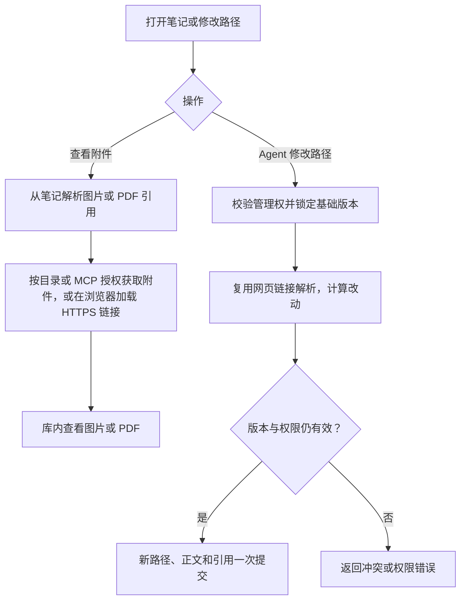

# 语料图片、PDF 预览和 Agent 链接更新

沿用 Obsidian Web Gateway 的附件链接和库内查看方式。点击笔记中的 Markdown 或 Obsidian 图片、PDF 链接，在工作台弹窗查看。图片使用浏览器原生渲染，PDF 使用本机托管的 Mozilla PDF.js，在桌面和手机提供翻页，支持 PDF 链接指定起始页。附件来自已登记的目录或 MCP 资料，或笔记中已有的 HTTPS 链接。目录附件读取限制在已发布版本的当前登记目录及笔记引用路径内。HTTPS 预览由浏览器按来源站授权读取，遇到来源站拦截时可打开原链接。

Agent 使用原 `resource_item_write` 修改笔记路径时，沿用网页的 Quartz Markdown 解析和链接改写函数。Worker 先检查管理权，确定基础版本和原路径，再调用私有 Harness 桥接计算变更。最终提交在原资源锁内重新校验版本、权限和操作编号。旧编号重试返回同一回执。正文同时修改时，用提交的正文来计算新路径的相对引用。

验收使用有图片和多页 PDF 的隔离语料，覆盖桌面、390px、指定页、丢失附件、异常路径和越权读取。通过实际 MCP 工具移动笔记并读回所有改动，覆盖同编号重试、并发写入、撤权和含歧义的双链。正式环境用现有库做只读验收。

参考 [Obsidian 嵌入规则](https://obsidian.md/help/embeds)、[Obsidian Web Gateway](https://github.com/zhangchaosd/obsidian-web-gateway/blob/99901b27d040360516b54ff86b7214908488ae2a/web/src/markdown.ts) 和 [PDF.js 显示层](https://mozilla.github.io/pdf.js/getting_started/)。
