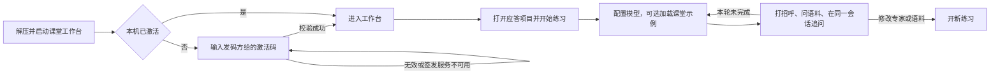

# 课堂版首次使用

参考 [Ollama 本地运行方式](https://github.com/ollama/ollama/blob/main/docs/api/introduction.mdx)、[Temporal CLI 桌面平台](https://github.com/temporalio/cli/blob/main/README.md) 和 [MySQL 官方压缩发行包](https://dev.mysql.com/doc/refman/8.4/en/windows-choosing-package.html)。课堂下载包用本机进程运行现有组件，再打开原生网页。Mac 和 Windows 分别打包。

空项目可以用内置的「通用客服专家」打招呼。「加载课堂示例」把可编辑专家和虚构语料放到当前项目，允许直接验证检索、追问和修改。已有配置保留，学员决定何时切换专家或语料。设置面板复用现有 UI，使用原生浅色和深色主题变量。

课堂启动器固定启用现有激活门，随包只提供验签公钥。开源自部署和正式运行仍使用各自的现有配置。模型密钥由学员填写。执行失败按练习失败显示并允许同会话继续，明确请求转人工仍保留原行为。
