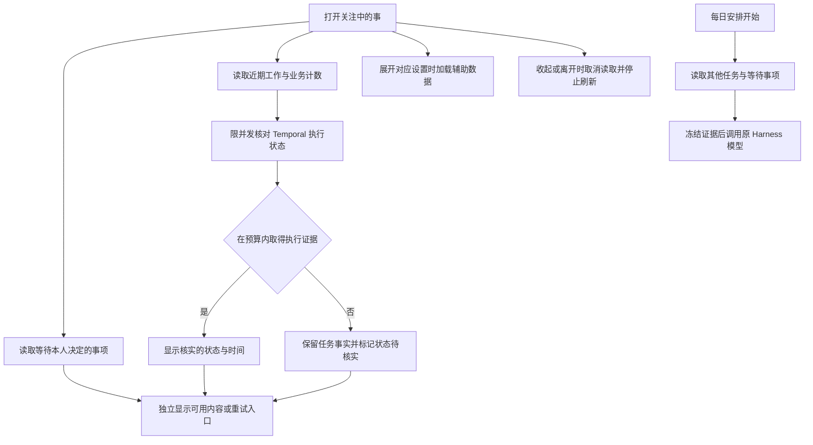

# 关注中的事与工作台稳定性

## 参考

- [DeepSeek Harness 官方仓库](https://github.com/deepseek-ai/deepseek-harness) 使用插件组织模型、工具、会话和界面扩展。继续使用当前安装版本的 Cordis 插件槽及原生 Session。
- [Temporal Visibility](https://docs.temporal.io/visibility) 的列表存在索引延迟，特定任务用 Describe 核对。MySQL 提供业务记录，Temporal 提供执行状态，两个来源保留各自语义。
- [TanStack Query](https://tanstack.com/query/latest/docs/framework/react/reference/classes/Query) 的在途请求合并和取消机制可作为浏览器刷新参考。本次使用现有 React 与 Fetch 实现。
- [MySQL 排序优化](https://dev.mysql.com/doc/refman/8.0/en/order-by-optimization.html) 说明索引和 LIMIT 对有界查询的影响。先减少重复读取，保留现有表结构。

## 产品需求

- 待决定和近期工作独立呈现。某个区域失败时提供该区域的重试。刷新期间保留同一视图上次读取的结果，并提示刷新错误。
- 规则记忆、定时工作、本人通知、每日安排均由现有折叠区按需读取。保留原布局、按钮、原会话跳转和写入入口。收起、切到配置、离开页面或标签页不可见时停止轮询。用户修改成功后按原接口刷新受影响的区域。
- 原近期任务上限为 100。近期任务的实际执行核对使用固定并发上限和整轮截止时间。成功、失败、发布和渠道回执各使用现有证据。状态超时时标为待核实。
- 每日安排的输入排除本轮自身。保持冻结输入和原 Session。旧总结仍作为历史记录。
- 沿原生会话、任务调度与恢复、资源权限、消息及运营回执、渠道、部署和界面检查现有入口。修复可复现的缺陷，覆盖权限、失败、重试与并发。生产状态使用独立读回。

## 职责

Cordis 插件呈现工作台视图，原生 Harness 管会话和模型，Worker 管业务读取与 Temporal 调度。业务工具继续经现有 MCP；本人界面使用现有认证接口。直接采用 Temporal Visibility 批量列表会改变状态时效；额外持久化状态会引入重复状态及迁移。此轮给实际执行查询设预算，保留当前状态来源和旧数据兼容。

## 验收

- 用慢接口和失败接口验证待决定先出现，折叠区无提前请求，隐藏后无后续轮询，超时可重试且原数据保留。
- 用合成延迟测量同一批次串行核对和有界并行耗时，检查同时在途数量及超时的状态语义。校验同一任务的继续执行和时间字段。
- 验证每日安排排除当前任务，且已有运行、失败和完成状态可以追溯。
- 运行 Host/连接器、Worker、发布控制器回归；可用环境中补真实 Harness 与隔离 MySQL/Temporal 验证。
