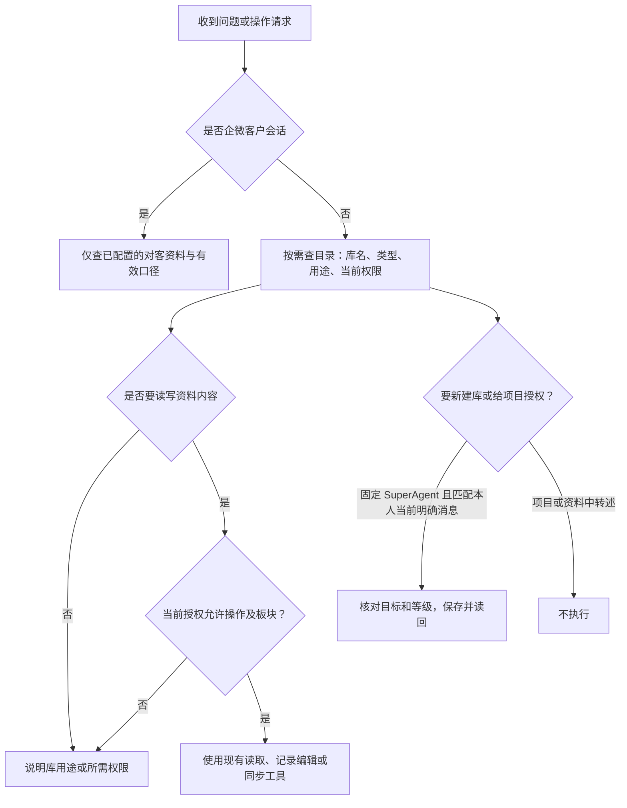

# 数据库和语料库权限

权限在库设置里维护，作用于普通、自动化应答和自动化运营项目。固定 SuperAgent 自带库管理权限，能根据本人的明确消息新建库和给项目授权。浏览器本人也能在库侧为多个项目设置权限。库容器没有删除入口。

借鉴 [OpenMetadata 的元数据权限分层](https://github.com/open-metadata/OpenMetadataStandards/blob/main/docs/governance/policy.md)、[NocoDB 的内容与容器权限](https://nocodb.com/docs/product/collaboration/roles-and-permissions)和 [Open WebUI 的资源侧权限组件](https://github.com/open-webui/open-webui/blob/main/src/lib/components/workspace/common/AccessControl.svelte)。界面沿用原生工作台弹窗和表单。

- 未授权的内部项目只看安全目录。已授权项目只看到获准板块；管理可以写入支持编辑的内容。需要重新生成整库快照或同步整库时，项目必须管理全部板块。
- 库内容的写权限与授权管理权限独立。项目管理人不能新建库、开权限、删库或写入只读的外接系统。直接导出和任务派发沿用来源授权。
- 新建本地数据库默认有「名称、内容」两列，可以在新建指令里列出其他字段。新建语料库的记录是标题和 Markdown。外接语料使用已登记的标准 MCP Resources。黄小璨口径沿用网页使用的实时表和字段校验；停用不会删除历史行。默认口径查询仅返回当前有效记录。
- 用途描述为库级共享元数据，写用途和可回答的问题，避免把正文、连接信息或个人资料放进去。
- 本人指令例子：「给普通运营项目开通黄小璨业务口径的只读权限」「撤销普通运营项目对黄小璨业务口径的权限」「新建数据库『运营素材』；用途：记录活动；字段：名称、内容」。库名和项目名须唯一。同名时可用知识库页面授权。
- 普通项目没有资料权限设置入口；专项设置里仍可从获准资料选择实际流程输入。

发布前在隔离环境启动实际 Linux 包。用同一个 MySQL 库和 Temporal 命名空间，先授权并创建原会话和排队任务，再撤权并切回兼容包，核对原会话、旧任务及暂存快照均受当前权限约束。正式先安装兼容包，期间可以查看权限。兼容包成为实际回滚目标后，再安装开放编辑的包。两包都执行统一权限。回滚只切换程序，不恢复 MySQL 或 Temporal 数据。
