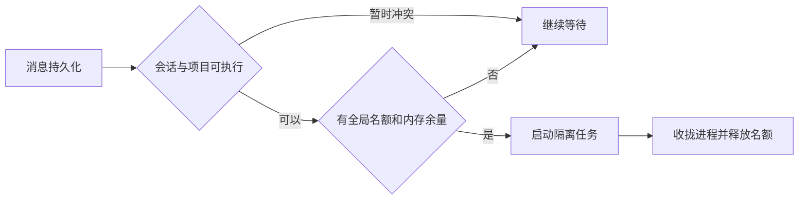

# 客户应答等待与工作台并发

业务流程：已授权客服和客户 → 私聊文字持久化 → 人工会话只记历史 / AI 会话入队 → 等待可用资源 → 复核会话版本 → 专家执行 → 复核版本并发送或按业务原因转人工。收到消息后经过的时间不改变会话模式。网关返回 unknown、执行失败、人工已介入等仍沿用原流程。

本次实现取消原业务时限，兼容旧绑定和排队数据；不改变接入范围。长期设计以工作台总共十个运行名额为目标，覆盖个人助手、各项目、客服和后台任务，已排队未执行的任务不占名额。

1. 复用持久化 runs 和同一调度器。全局最多十个运行，项目间轮询，前台交互优先，后台提供最低服务机会。一次出队时原子取得全局名额、会话顺序和资源预算；跨进程恢复前确认旧容器已退出。
2. 同一会话串行。同项目客服的不同会话仅在运行目录、历史、授权工具和知识快照隔离后并行。可能修改共享资料或通过工具写共享状态的任务继续使用项目写锁；读写并存应使用稳定快照，否则互斥。独立工作进程和工具子容器均计入资源预算。网关发送按客服账号限额单独排队。
3. 4 GiB 属于目标机器规格，10 是调度上限而非最低启动数。按任务类型测 cgroup 峰值，将系统、回调、数据库和其他常驻服务预留在预算之外。名额或内存不足则继续持久排队，过载时停止接新运行。以分级混合负载测试校准名额，不能只压十个轻量问候。
4. 在隔离机阶梯压测 2、4、6、8、10 个运行，含客服检索、个人任务、普通项目写入及后台任务；观察 MemAvailable、内存压力、swap 读写、OOM、回调确认时延、队龄、项目饥饿和发重/串话。按网关合同 5 秒内确认，所有测试输入可对账，零串话、重复发送及 OOM；持续高压或队列不收敛时下调实开数。

参考：[网关投递和发送策略](https://wecom-gw.zhishicat.com/api-docs.html)、[容器资源约束及实测建议](https://docs.docker.com/engine/containers/resource_constraints/)。

## 当前交付：全工作台六并发

根据 4 核、3.64 GiB 主机的 2/4/6/8 阶梯实验，本轮全局执行上限定为 6。6 档混合任务通过，8 档触及测试保护线。十槽是后续设计。本次复用一个 Worker 和持久化运行队列，不复制项目、不修改企微客户范围。

调度与 Harness 两处各有职责：数据库仲裁项目写入、客户会话与队列顺序；宿主在启动进程前复核总数和可用内存，连同直接运行的路由、归档、整理合计不超过六个 Harness。网关回调入库和发送回执处理不消耗模型执行名额。技术验收覆盖同项目多客户、同会话顺序、项目写入互斥、重启、取消和正式配置读回。

六席可以全部交给不同客户的只读任务。「今天」参与同一总量，并在有任务排队时优先取得下一可用席位。普通项目独占写任务保持最多两个。绑定带有 CLI、stdio 或未经授权的 MCP 时，继续按项目独占；宿主的 GatewayConcurrentReadMCP 按 projectId、pluginId、HTTPS URL 精确授权仅提供查询的项目插件。

Linux 启动水位为总内存的四分之一，上限 896 MiB。对准备启动的轻任务和普通项目任务分别暂记 192 和 384 MiB，直到容器拉起后的五秒；这只是启动准入估算。项目锁、内存或名额不足时等待，清理失败的容器须确认移除才能释放名额。模型请求数、辅助工具子进程和网关每账号发送额度分别受各自的原有约束，六席统计的是主 Harness 执行。
