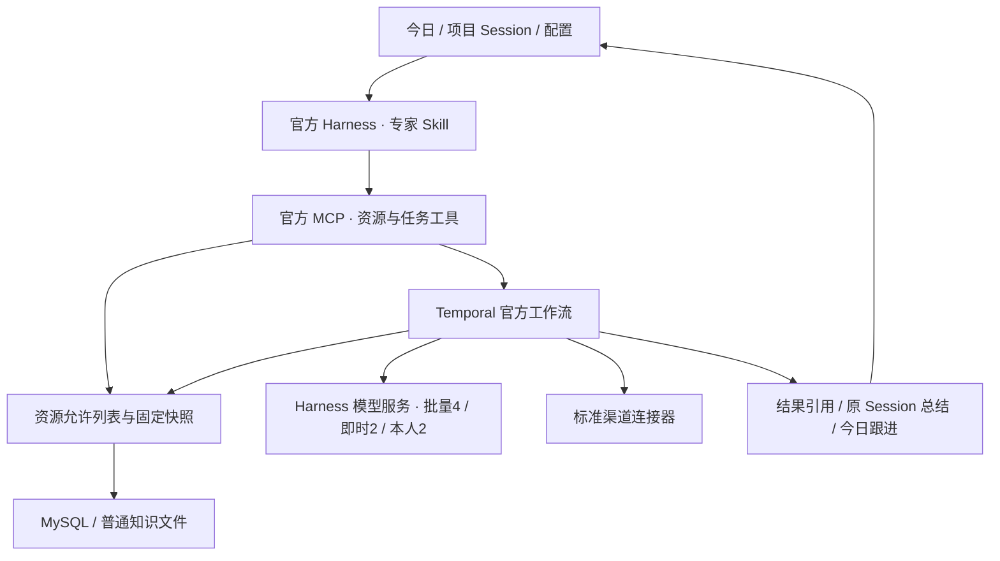

# 通用扩展契约

## 四层及固定边界



所有本地服务仅绑定 loopback；浏览器继续使用 Harness 本人登录。内部服务使用一个安装凭证，不引入用户角色、租户或策略平台。项目资源隔离由允许列表保证。本人配置接口与模型工具分开；个人 Agent 的全局读权不传给项目任务。

## 资源是配置，专家是方法

连接支持 MySQL、HTTP JSON、JSONL、Markdown/TXT 目录。HTTP 连接使用固定 HTTPS 地址，凭证从宿主私有环境读取；JSON Pointer 映射记录键和字段，下载完整性、Schema和数量阈值通过后发布。数据库资源选择表/视图、唯一主键、可选水位；目录资源选择已有目录下的子目录。每个板块列出字段或 RFC6901 JSON Pointer 映射。来源完整记录仍留在版本中，专家只得到选中的板块。

新资料加入方式：本人注册连接→注册资源及板块→勾选项目→专家 `resource_list`→`resource_sync` 或 `program_run`→固定版本读取。共享默认只读；需要小于板块的范围，发布数据库视图或独立资源，不增加行级权限表达式。

知识查询先用 `resource_search` 返回命中附近的短片段，再用 `resource_excerpt` 按记录和字段分段读取正文（默认2000、最多4000字符，返回 next 游标）。普通 `resource_read` 有48KB返回预算；长文档不塞进单次工具结果。目录导入上限每文件256KiB，总计32MiB，可拆多个资源。

清洗使用资源配置的 JSON Schema、trimFields、切片映射与确定性程序。复杂清洗优先来源视图或已有转换工具。需要模型判断时注册版本化方法，再运行同一批量生成流程。每次发布先暂存、校验，再原子切换指针；正在生成的任务保留原快照。

方法资源正文是 JSON：`name`、`instructions`、`requiredFields`、`maxInputBytes`、`maxOutputTokens`、`outputSchema`。Skill 告诉 Agent 如何发现与选择方法资源；`methodRef` 固定资源、版本、板块、记录。客户阶段、活动优先级及专业判断只放方法，不进入工具代码。实际字段以 MCP `tools/list` JSON Schema 为准。

## 标准 MCP 接入

使用 MCP 官方 SDK，优先 Streamable HTTP；不新建插件协议。每个工具具有稳定名称、用途、JSON Schema 输入及 `structuredContent` 输出；ToolError 表达业务拒绝，客户端不能把 HTTP 200 当业务成功。

本人在 Harness 的 Cordis 扩展配置增加 `toolServers`：

```yaml
toolServers:
  - name: documents
    url: http://127.0.0.1:7390/mcp
    tokenEnv: WORKBENCH_MCP_DOCUMENTS
    projects: [项目注册后得到的稳定编号]
    personal: false
    sources:
      - resourceId: 已注册的来源资源编号
        version: 已发布的固定版本
        section: 开放的板块编号
```

服务部署也可将同一数组写入宿主私有环境 `WORKBENCH_TOOL_SERVERS`（JSON）；启动 patch 直接映射给既有 `toolServers`。这里只声明地址、项目、工具及资源引用，实际密钥仍由 `tokenEnv` 指定。

正式密钥来自环境变量，不能出现在该配置。宿主使用官方 MCP 客户端加载；工具按 `serverName` 分组，无需修改宿主源码。HTTPS 外部地址或本机 HTTP；禁止 URL 凭证与查询参数。客户对象 Session 默认不开放额外服务。确有必要时，由本人同时配置非空 `customerTools` 工具名称白名单和 `sources`。只允许本项目接入设置勾选的公共资料快照；调用前后均检查实时共享范围并登记来源。个人资料只能走可信对象绑定，不能通过外部查询工具读取全库。

服务器名称只允许1～32个字母、数字或连字符，并以字母或数字开头；不使用下划线，也不能重复，以免与 MCP 的工具命名分隔符混淆。

宿主附加 `X-Workbench-Kind`、`X-Workbench-Project`、`X-Workbench-Session`，这些来自已绑定会话，工具参数不能覆盖。服务必须校验自己的 token。每个扩展必须在本人配置中声明非空来源引用；宿主在工具调用前后检查读取范围，并记入 Session 来源链。该范围随派发及产物继续检查，不能通过“今日”转交给无权项目。取消共享会阻止后续调用和分享。

额外服务是可信扩展，返回内容必须来自声明的资源范围；若要读项目资料仍使用既有资源服务，不能使用任意 SQL/路径工具代替资源检查。动态外部数据先由连接器发布为资源版本，再供 Agent 使用；不要在声明固定版本时静默读取未发布的实时全库。新增数据库仍通过连接/资源配置，不给模型数据库密码。

长任务提交工具立即返回 `runId`，通过 `run_get`/`run_steps`/`run_items`查询，失败后用原 `runId`继续。MCP Tasks 扩展不是当前 Harness 基线依赖。`operationKey`在原 Session 内表示同一次业务意图，重试复用，新增一轮才换键。

## 批量与工作流

默认200条主键游标；每人独立切片和预算；模型批量并发4，本人/即时配额独立。Temporal History 只放标识和必要状态；结果存MySQL，分页 Continue-As-New。不得用进程内数组或 cron脚本替代持久任务状态。

`program_run` 将多个资源刷新与生成放进一轮。定时使用 Temporal Schedule 的同一程序，不让模型每天重新规划。总结是独立反馈：刷新页面、总结失败、通知重试不重跑业务。资源撤销会阻止后续读取与重试；任务取消必须等已启动活动退出后释放项目写入占用。

需要新的流程时用 Temporal 官方 SDK 的 Workflow/Activity/Child Workflow/Signal/Timer，不增加通用状态机编辑器。每个副作用必须有稳定标识和可查结果；方法推理只在必要步骤调用模型。

## 通知、确认和自动应答

标准连接器暴露 `message_send` 与 `message_receipt`。输入包括 connectionId、idempotencyKey、target、text；查询只读取原标识。输出 state 为 accepted/pending_confirmation/sent/delivered/failed/unknown，receipt 保存可核实的平台编号。连接器不要自行无限重试发送。

批量发送：生成产物 + 本人注册的资格资源/JSON Schema条件→程序筛选→固定稿件和对象→原 Session 与今日抽检→本人确认→提交→原回执查询。目标来自资格资料，不能来自模型输出。资格版本改变后旧批次不能继续提交。确认接口仅本人网页或绑定本人渠道可用。

自动应答复用消息去重、对象绑定 Session、允许的上下文记录、专家 Skill、reply/ignore/handoff 工具。人工接管后不能由同条消息恢复自动回复。不增加场景专属后台。未知归属消息不读取项目正文；裸“发”须有可信平台时间与唯一待确认事项，否则使用八位审核码。

## Skill 包及验收

遵循 [Agent Skills](https://agentskills.io/specification)：目录含 `SKILL.md`，frontmatter 包含 name/description，方法说明尽量短，长资料放 references 并按需加载。用户资料留资源库，包内只放方法和通用样例。Harness 沿用官方 skill-filesystem/tool-skill 插件。

新工具至少验证：官方 SDK tools/list/call、Schema拒绝无效输入、身份不可覆盖、共享撤销、幂等、取消/恢复、数据预算、第二种任务复用。外部操作额外验证超时未知不会重发，以及真实结果与连接器受理的区分。真实模型/渠道、模拟模型/渠道分别记录。


## 自动应答的标准适配

专项配置与使用见 [AUTO-REPLY.md](AUTO-REPLY.md)。网关只做协议与可信身份转换；默认专家方法是 `customer-reply`，可替换为其他 Skill。MCP仍为现有 message_context、resource_search、resource_excerpt、message_reply、message_disposition、message_receipt，不增加业务专用生成器。

人工接管递增现有路由版本；项目配置也有独立递增版本。两者任一改变均阻断未提交旧草稿。队列与提交均按同客户顺序处理，直到前条真实请求返回受理/失败/未知；不等客户已读，未知结果不重发。明确未提交的 prepared 任务可恢复原编号，已提交的任务只核原回执。
