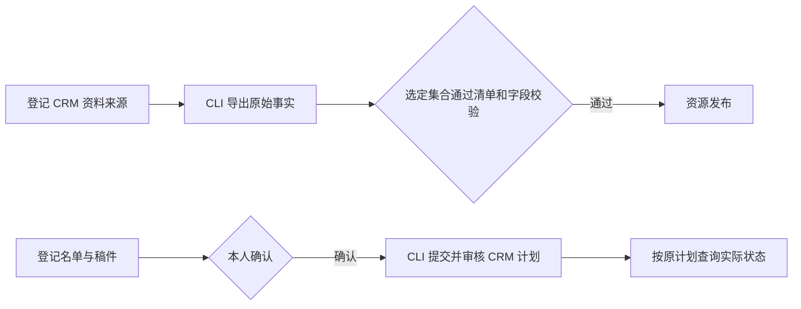

# CRM CLI 基本运营工具

同一个标准 MCP 服务提供三个专项入口，沿用工作台原有资源同步、批次确认和回执查询。CLI 命令来自当前 CRM 目录，工具注册沿用 [MCP Go SDK](https://github.com/modelcontextprotocol/go-sdk)。原 HXC 直采和策略选单另行处理。

| 入口 | 输入与结果 |
|---|---|
| `data_refresh` | `{operationKey,destination}`。对已登记 CRM 来源执行 `customers archive-facts export`，按现有资源字段投影、清洗和发布，返回 `runId`。用 `run_get` 查状态、条数和发布结果。 |
| `crm_push` | 复用 `message_batch_prepare` 的 `operationKey`、`title` 和 `plan`。名单与正文取固定引用，本人确认后调用 CRM CLI 计划与审核操作。用 `message_batch_read` 读原批次与计划编号。 |
| `crm_receipts` | `{planId}` 或 `{runId,deliveryId}`。查询该工作台已经关联的原计划，返回当前逐人记录并触发原回执读回。用 `message_batch_read` 查看更新后的状态。 |

采集连接由本人登记为 `kind: crm-archive-cli`。`secretEnv` 使用 `WORKBENCH_SOURCE_` 前缀，引用宿主环境中的 JSON 配置 `{cli,origin,clientId,clientSecretEnv,requestFile}`。程序与请求文件使用绝对路径。`clientSecretEnv` 指向 `WORKBENCH_SOURCE_` 前缀的机器密钥环境变量。每次采集经 CRM 原机器授权接口申请短期只读令牌，再调用 CLI 导出。请求文件为原导出合同的 `{"hxc_account_ids":[...]}`，使用准确、已授权的账号标识。CRM 机器权限和来源 IP 由原服务校验。

资源沿用 `jsonSource.arrayField/keyPointer/fields`、`trimFields` 与 `recordSchema`。每个资源登记一个导出集合，例如 `customers`、`orders`、`messages` 或 `surveys`。同步验证该集合的原清单条数和 SHA-256，再按现有发布规则切换。允许使用既有 `program_schedule` 定时刷新登记资源。

推送沿用本人登记的资格资源及字段绑定，名单可由本人提供。资格检查绑定 CRM `customerId`、`staffId` 和同一业务动作的稳定 `businessSlot`。连接器沿用明确允许的客户范围、原请求标识、原计划审核和外部结果未知时只查回执的处理。平台受理、待员工确认、实际发送和失败分别记录。

发送通道配置 `kind: crm-cli`、`cli` 绝对路径和 `allowedCustomerIds`，以 `cliEnv` 绑定现有 CLI 本人会话的配置目录及凭据文件。工作台连接登记同一通道 ID 和 `kind`，使用已有 MCP 通道地址与项目授权。
