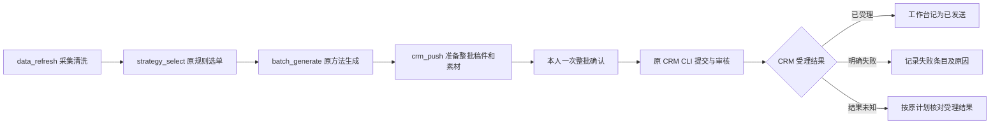
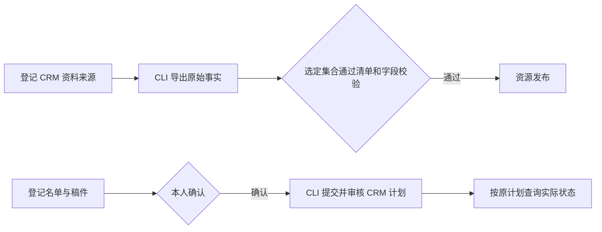
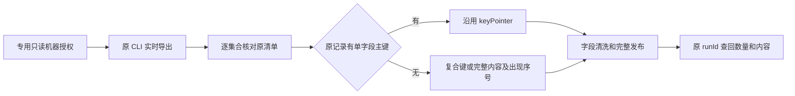

# 五个运营工具

本轮候选复用同一 MCP 服务、原 Harness 生成、Temporal、MySQL 和 CRM CLI。正式安装与真实业务验收状态见 [实现记录](../../docs/IMPLEMENTATION.md)，不能以本说明判断已上线。

| 工具 | 本轮调用合同 |
|---|---|
| `data_refresh` | `{operationKey,sources,destination}`。来源按原始资料、联系历史、策略、方法排列，均为已登记的 `operations-original` 资源；同轮复用一份真实采集与清洗结果。返回 `runId` 和四份 `inputRefs`。 |
| `strategy_select` | `{operationKey,data,strategies,history,destination,asOf,strategyKeys,limit}`。三个输入固定版本；`asOf` 使用本轮清洗结果的 `archive.generated_at`。`limit:0` 保留全部合格成员，排除原因从 `run_items` 读取。 |
| `batch_generate` | 沿用现有 `{operationKey,sources,destination,methodPointer,methodRefs}`。`methodPointer` 为 `/actions/0/generation/skill_key`，方法引用来自本轮采集；大批使用原 `selection` 分页，每段至多 2,000 人。 |
| `crm_push` | `{operationKey,review:{selection,drafts}}`。收齐同轮原选单和生成段，返回整批待确认任务；准备期间可创建并读回 CRM 素材，发送计划在本人确认后创建。 |
| `crm_receipts` | `{runId}` 查询原整批任务，或 `{planId}` 查询已绑定原计划。返回已保存的逐人结果，提交结果未知时查回原计划。已受理在工作台显示为「已发送」，接口保留 CRM 受理与历史实际发送的原始状态。 |

长任务都使用已有 `run_get`、`run_items`、`run_steps` 和 `run_resume`。本人可用 `run_resume` 续办因已移除的校验而明确未提交的原确认任务。工作台先核对无 CRM 计划、无建单记录、无取消，再使用原任务和稿件继续。已有计划或提交结果未知时，查询原回执。没有合格成员时直接结束备稿。

固定定时入口为现有本人接口 `POST /operations/original-schedule` 的 `cycle` 配置，保存四份来源、三个目标资源和六份原方法引用；不使用通用 `program_run` 方案。先在同项目登记资源、原 CRM transport 和员工，再安装定时。原有新工作台分开的资料/策略任务由该入口暂停；原服务器的任务与配置保持只读。

常态服务与新人承接可配置在同一条日程。`cycle.additionalBatch` 指定第二条原策略及独立的名单、稿件资源。两包复用同轮清洗、策略、历史和方法快照，并按相同时间逐人判断，每包独立备稿与确认。未确认的往日稿归入历史。已确认批次可跨日继续执行或查询回执。新流程的发送权限使用项目已配置的 CRM 通道与员工，原直接发送模式启用时整批入口关闭。

## 工作台独立更新档案

使用现有运营日程和档案资源。在来源连接原有私有配置中登记只读数据库账号，并增加两个绝对路径。配置文件权限设为 `0600`。

- `hxcUnifiedOAuthFile` 指向包含 `clientId` 和 `clientSecret` 的私有 JSON。工作台直接向黄小璨申请 `operations.sync.read` 短期令牌，分页续跑时按有效期换取新令牌，沿用来源水位和快照语义。
- `independentInputs` 指向工作台管理的运营 JSON，包含 `history`、`methods`、`writing`。`history.strategies` 是按策略键索引的发布规则，`history.owner_policy` 是本地服务政策，`history.assets` 按原清洗脚本相对路径保存运营规则和素材配置。`methods` 按方法键保存已有方法记录的 `method` 内容，或兼容原方法资源数组。`writing` 沿用 `read_only: true`、`assets`、`newcomer_reference` 的现有写作资料合同。已有历史事实可按原 `history` 合同保留，之后使用工作台自己的工作包和 CRM 回执更新去重记录。

在现有 `POST /operations/original-schedule` 的同一 `cycle` 中设 `independentProfiles: true`，`profileDirectory` 指向本项目的档案资源。可以沿用已发布的资源，也可以用只登记 `main` 板块的本地资源启动。对应的 `data_refresh` 传入 `independent: true`。新模式从 CRM 和黄小璨采集一轮，先保存同轮资料，再分别处理档案与备稿。档案任务和备稿各有原任务编号，可用现有 `run_get` / `run_resume` 处理。例行失败不会暂停下一天的日程。

档案事实由固定脚本投影。仅变化的、已归属客户的问卷及会话进入现有 Harness 批量模型通道。专家超时或证据不足时保存当轮事实与已有的带日期线索。档案任务使用现有 MySQL 原子发布，知识库和用户档案页面读同一个版本。

确认入口继续使用 `/operations/source-confirm`，一次确认固定名单、正文、素材及员工。策略、权益、报告及来源数据的更新在下一轮备稿生效。连接器按原任务建单，自动调用 CRM 原预览与批准。批准前核对 CRM 保存的收件人和稿件，每张可编辑的 CRM 卡片只查一次，确保还是本人确认的内容。CRM 受理在工作台记为「已发送」，明确返回的错误逐条记录，未知结果沿原请求和原计划读取。原服务冷却从受理时点起算。

该口径复用 CRM 批准接口的整批原子受理，以及已有原计划查询。参考 [异步请求与处理状态](https://learn.microsoft.com/en-us/azure/architecture/patterns/async-request-reply)，这里的完成点是工作台向 CRM 交付。

规则验收见 [42 条策略矩阵](OPERATIONS-ACCEPTANCE.md)。旧自动化程序按用户要求保持现状；当前读取其联系和执行历史，不声称跨系统原子互斥。真实客户发送必须在正式任务库留下计划和逐人回执，不能在隔离库发送后丢弃业务记录。

## 兼容的 CRM CLI 基本入口

以下是同名工具保留的 CRM CLI 兼容调用方式，沿用原有资源同步、批次确认和回执查询。CLI 命令来自当前 CRM 目录，工具注册沿用 [MCP Go SDK](https://github.com/modelcontextprotocol/go-sdk)。全量原始采集与策略选单使用上文五工具合同。

| 入口 | 输入与结果 |
|---|---|
| `data_refresh` | `{operationKey,destination}`。对已登记 CRM 来源执行 `customers archive-facts export`，按现有资源字段投影、清洗和发布，返回 `runId`。用 `run_get` 查状态、条数和发布结果。 |
| `crm_push` | 复用 `message_batch_prepare` 的 `operationKey`、`title` 和 `plan`。名单与正文取固定引用，本人确认后调用 CRM CLI 计划与审核操作。用 `message_batch_read` 读原批次与计划编号。 |
| `crm_receipts` | `{planId}` 或 `{runId,deliveryId}`。查询该工作台已经关联的原计划，返回当前逐人记录并触发原回执读回。用 `message_batch_read` 查看更新后的状态。 |

采集连接由本人登记为 `kind: crm-archive-cli`。`secretEnv` 使用 `WORKBENCH_SOURCE_` 前缀，引用宿主环境中的 JSON 配置 `{cli,origin,clientId,clientSecretEnv,requestFile}`。程序与请求文件使用绝对路径。`clientSecretEnv` 指向 `WORKBENCH_SOURCE_` 前缀的机器密钥环境变量。每次采集经 CRM 原机器授权接口申请短期只读令牌，再调用 CLI 导出。请求文件为原导出合同的 `{"hxc_account_ids":[...]}`，使用准确、已授权的账号标识。CRM 机器权限和来源 IP 由原服务校验。

资源沿用 `jsonSource.arrayField/keyPointer/fields`、`trimFields` 与 `recordSchema`。每个资源登记一个导出集合，例如 `customers`、`orders`、`messages` 或 `surveys`。同步验证该集合的原清单条数和 SHA-256，再按现有发布规则切换。允许使用既有 `program_schedule` 定时刷新登记资源。

### 全量采集补齐

本次缺口是部分原始记录没有单字段主键。复用 [RFC 6901 JSON Pointer](https://www.rfc-editor.org/rfc/rfc6901.html) 定位字段，用 Go 标准 JSON 编码有序键值数组并取 SHA-256，避免字符串分隔符歧义和行序变化。`keyPointers` 的每一部分必须是非空字符串或 JSON 数字，缺失即拒绝整批发布。没有原始唯一键的数组可登记 `rowKey:"content-occurrence"`，使用完整原始行内容摘要和相同内容的出现序号保留所有行；行序改变不改变同一多重集的引用集合，内容变化会产生新引用。三种键方式互斥，不新增键表达式语言、身份匹配或客户主键。

范围为 CRM 原导出的八个记录数组：`customers` 使用 `/id`，`users` 使用 `/customer_id`，`orders` 使用 `/order_id`，`surveys` 使用 `/submission_id`，`answers` 使用 `/answer_id`；`identities` 使用 `[/kind,/scope,/normalized_value]`，`messages` 使用 `[/message_id,/customer_id,/participant_role]`。`activation_receipts` 原投影未提供回执主键，使用 `content-occurrence` 保留同一客户、渠道、时间下不同回调产生的重复投影。这些只是快照记录引用，不是 CID 或原回执主键。已有单字段资源合同不变。

验收依次完成机器授权、真实 CLI 导出、正式工具逐集合刷新、原任务重复调用及独立内容读回。对复合键验证字段分隔、类型、大小写、行序和缺键拒绝，隔离 MySQL 验证非法重复键不替换已发布资料，以及无主键回执的合法重复投影全部保留。原包还含名称映射、首次联系映射和 HXC 身份对账输出，这八个数组不代表包内所有字段均已作为资源发布。HXC 原始权益与使用记录不属于 CRM 档案导出，此验收不代替 HXC 来源或策略与业务发送验收。

推送沿用本人登记的资格资源及字段绑定，名单可由本人提供。资格检查绑定 CRM `customerId`、`staffId` 和同一业务动作的稳定 `businessSlot`。连接器沿用明确允许的客户范围、原请求标识、原计划审核和外部结果未知时只查回执的处理。平台受理、待员工确认、实际发送和失败分别记录。

发送通道配置 `kind: crm-cli`、`cli` 绝对路径和 `allowedCustomerIds`，以 `cliEnv` 绑定现有 CLI 本人会话的配置目录及凭据文件。工作台连接登记同一通道 ID 和 `kind`，使用已有 MCP 通道地址与项目授权。

## 本次来源切换的回滚

回滚前先用已有日程暂停入口暂停本地运营定时，等待正在清洗、生成或提交的原任务收拢；结果未知时继续保留原计划查询，不换编号提交。然后走固定 `rollback-today.sh` 退程序与单元。若退回尚无本地 `cycle` 的上一版，通过原 `operations/original-schedule` 接口恢复原 `hxc:onboarding` 的 09:00 配置，保持新本地定时暂停。不得回退 MySQL 或删除确认、发送回执；原服务器任务不变。来源私有配置与原素材模板是兼容追加项，不作为客户发送授权。
