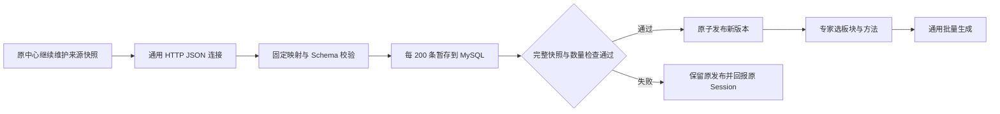
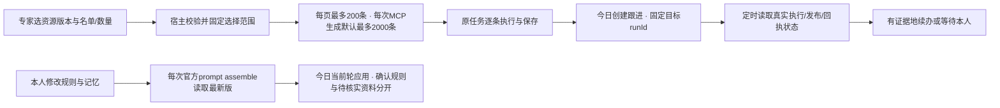

# 来源接管与不兼容切换补充 PRD

当前验收 MySQL 视图指向旧工作台插件维护的数据；这只能证明读取与生成，不能作为清退旧插件的依据。新工作台必须直接读取仍在运行的外部来源。

复用 Go 标准库 HTTP CookieJar、流式 JSON Decoder、已安装的 RFC6901 JSON Pointer、JSON Schema、现有资源发布及 Temporal Sync。连接只接收本人配置的固定 URL；模型不能指定 URL、凭证或 SQL。HTTPS 支持标准请求头、Basic Auth 和同源表单登录。表单参数/CSRF cookie 名均由私有连接配置给出，不硬编码某业务系统。拒绝跳转，避免凭证跨源传递。

HTTP 数据支持顶层数组或对象内一个指定数组。每条用标准 JSON Pointer 指定键和字段映射，保留原文可通过空指针映射到资料字段。全响应按字节上限存入临时文件并算 SHA256；只有完整下载才开始同一版本暂存，重试遇到不同输入拒绝混用。流式解析逐条校验，200 条落库，不把全文交给模型。发布检查支持最少条数及相对上一版本的数量下限；配置为通用数据质量规则，不硬编码用户/活动。

验收：同一连接运行原中心真实快照；停用旧工作台插件依赖的隔离测试仍成功；登录失败/跳转/截断/重复ID/来源变化/数量骤降不能覆盖已发布版本。别的 JSON 数据源只改配置。

研究依据：[Go HTTP CookieJar](https://pkg.go.dev/net/http/cookiejar)、[流式 JSON Decoder](https://pkg.go.dev/encoding/json#Decoder)、[go-openapi/jsonpointer](https://pkg.go.dev/github.com/go-openapi/jsonpointer)。不增加 ETL 平台或新流程语言。

切换仍使用 /opt/project-workbench 固定控制器、一把锁、current/previous。本次是用户明确授权的新库初始化与不兼容切换；旧程序数据先做本机一致备份并恢复校验，切换失败在提交前可回退旧服务。新架构通过生产读回后清退旧工作台代码、数据及插件，原上下文中心和 CRM 不变。旧库不能覆盖新库；首次新架构可只有一个正式版本，后续保留上一成功的原生版本。旧架构恢复依赖本机备份，不伪装成可直接回滚到新数据库的 previous。

打包使用固定官方Linux Node 24.22.0与Temporal 1.32.2，运行二进制版本和ELF/amd64校验；npm使用锁文件，仅允许固定版本原生依赖的安装脚本（node-pty/koffi/protobufjs），不全局放开。[npm安装脚本管理](https://docs.npmjs.com/cli/v11/commands/npm-install-scripts/)说明当前默认跳过未许可脚本，不能将成功解包当作原生模块可运行。Linux官方Host必须实际启动与模型读回。

## 新安装演练补充：三个通用入口

批量选择复用JSON Schema有界列表、现有版本快照与主键游标，不新增名单服务：可传recordIds或limit，外部MCP单次最多2000；不传时默认2000，不能隐式遍历25000人。内部Temporal容量测试仍可使用10000条。新参数保存在原Run，续跑保持原范围。

今日复用上游`system-prompt/assemble`异步事件与当前`Memories`允许列表；`agent/pre-step`发生在assemble之后，不能在那里更新当轮提示词。persona不再启用complete模式，以免抑制工作台方法段。每轮替换当前记忆段，不累加历史副本；未确认项不能当本人规则，忘记项不加载，来源继续追踪。

跟进增加可选targetRunIds，创建及复查均核对原任务访问范围，复用现有RunOverview的Temporal状态、逐项计数、发布状态与真实回执统计。模型不能凭Goal中的编号猜完成。资料首页只作为明确标注的样本，不能据此认定整个数据集完成。参考实现继续使用官方Temporal SDK的DescribeWorkflowExecution/Timer/Signal和Harness原生系统提示组装，不增加新编排层。

一致性备份期间，在同一发布锁内先停止旧入口、旧渠道与旧插件。guard保存停机前渠道/插件的活动标记及准确旧current；本机恢复验证完成后才允许新系统切换。控制器据此前活动标记恢复/启用渠道，避免“备份时已停渠道”被误解为本人原本禁用渠道。备份或验收失败且尚未提交时恢复旧服务；提交后不得倒退游标。
