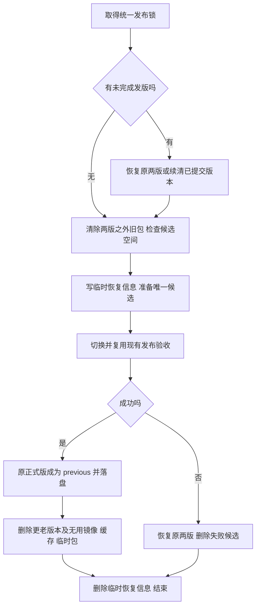

# 持续发布资源保留：极简 PRD

2026-11-02。范围：项目专家工作台 / 个人工作台。状态：已接入现有脚本并安装生产固定入口，已完成首次旧资源清退；正式应用版本未改变。

## 第一性原理

只有三个实际需求：**线上能继续运行、失败能退回上一成功版、发布资源不随次数累积。** 因而只需要两个完整版本和释放它们之外的资源。业务数据独立于版本，不应每次复制；层数不是版本数，必要共享层不能删。

保留一把发布锁、两个版本指针，以及一次发版期间的临时恢复信息。去掉独立资源清单/引用图系统、计划器、采集器、generation、候选租约、清理收据、专门验证模块及新增后台 timer。既有业务发布验收继续复用。

## 业务流程

空间不足就阻止新候选；清理失败就保留临时恢复信息并说明剩余项，不进入下一次普通发版，也不回退已经成功的正式版。

## 市面做法与取舍

| 方案 | 借用内容 | 不引入的部分 |
| --- | --- | --- |
| [Capistrano](https://capistranorb.com/documentation/getting-started/structure/) / [Deployer](https://deployer.org/docs/8.x/recipe/deploy/cleanup) | releases + current，发布后轮转 | 不为本项目再安装一套发布平台；用 previous 明确保留上一成功版 |
| [ECR 生命周期](https://docs.aws.amazon.com/AmazonECR/latest/userguide/LifecyclePolicies.html) | 按数量控制历史制品 | 不新增云镜像仓库、策略预览和审计系统 |
| [Podman 4.9.3](https://docs.podman.io/en/v4.9.3/markdown/podman-system-prune.1.html) | 引擎负责镜像依赖和在用保护 | 不自己实现镜像层引用图，也不全局 prune unused 镜像 |

选择：直接给现有脚本加轮转与失败恢复。全量、前端增量、回滚与镜像构建共用同一把锁；不另做产品模块。

## 保存和删除

| 对象 | 规则 |
| --- | --- |
| 正式版 / 上一成功版 | 各一个；包含程序、前端、必要配置及运行依赖 |
| 候选版 | 发版中临时一个；成功轮转，失败删掉 |
| 运行镜像 / 共享依赖 | 两版需要的保留，其余本项目资源删除；引擎仍在使用的项不可强删 |
| 业务数据 / 凭证 / 当前工具 | 原位保留，不参与版本清理，不因回滚而倒带 |
| 全量数据快照 | 普通发版不创建；必要迁移最多一份恢复点。SQLite 用 [一致性备份](https://www.sqlite.org/backup.html)，不硬链接活跃 DB |
| 更老 release、旧回滚、前端归档、预览、构建/上传临时文件 | 发版结束即删，不留额外本机制归档 |
| 退休旧环境 | 全部清退其工作台代码、数据、缓存及启动入口；不再等七天 |
| 清理收据 / 专属统计日志 | 不创建 |

前端补丁也计入两个组合版本，保留两个入口各自依赖的资源即可；未变文件可共享，但已发布内容不原位覆盖。一个月不发布也不按年龄删掉 previous。

首次清退范围包括旧 `/opt/yihaowei-workbench`、`/opt/deepseek-harness`、`/opt/workbench-development` 及其对应旧数据、缓存、配置、预览和服务。先确认当前配置、两版依赖和进程没有引用这些位置。公司官网、当前 `/var/lib/project-workbench` 业务资料及共享系统组件不在清退范围。通配符只用于发现对象，不能直接批量删除不明目录。

## 必要的中断恢复

`.deploying` 只保存 `old_current`、`old_previous`、`candidate` 三个路径；准备候选前原子写入，正常结束删除。不是清理日志，也不长期归档。

- **提交前中断**：previous 仍为 old_previous。将 current 恢复为 old_current，保留原两版，删失败 candidate。即使 current 已临时指向 candidate，也按此恢复。
- **提交后中断**：current 已为 candidate 且 previous 已为 old_current。保留这两个版本，继续清理剩余旧资源。
- **指针不符合以上状态**：说明有外部变动或旧入口绕行，停止删除，重新核对；不能猜。
- 顺序必须是“候选生产验收通过 → previous 原子更新并落盘 → 解除发布失败回滚 trap → 清理旧版”。清理没完成前不得删除临时信息。

主动回滚不生成新包，临时文件的 candidate 就是原 previous；成功交换两个指针，失败恢复原指针及改动配置。失败清理只作用于原两版之外的对象，不能删掉原 previous。若原正式版已确认故障不可用，删故障版后暂留恢复成功的一版，下一成功发布再自然补齐两版。

第一次接入先从现有成功发布记录确定 previous，并在两个版本目录写入各自实际使用的完整镜像 ID。以后只随发版维护这两个指针和这两行镜像信息，不为每次清理扫描并建立整机资源图。

## 对抗性推演与必要保护

| 反例 | 极简设计如何处理 |
| --- | --- |
| 最新目录其实是失败候选 | previous 来自上次成功的 current，不从目录时间推断 |
| 先删旧回滚腾空间，新包又失败 | 两个保留版本不参与发布前腾空间；不足就停止 |
| 切换后断电，上一版信息丢失 | 临时三路径先落盘；按两个指针判断恢复或续清 |
| 清了一半进程退出 | 临时信息仍在；重复删除已不存在的旧对象可跳过，下一入口续清 |
| 两个发布或构建同时进行 | 入口统一持锁，等旧入口结束后再接管；不能只给清理单独加锁 |
| 没有容器运行，回滚镜像被判 unused | 明确保留两版镜像 ID；不用 prune -a。按本机支持的无 force、无自动删父镜像选项定点删除 |
| overlay/diff1 看着多余，实际上仍登记 | 不手删底层目录；用引擎移除无用镜像。异常层未解决就如实说明，不承诺一次全部回收 |
| 回滚旧数据库导致新消息消失 | 常规回滚保留当前业务数据、渠道游标和业务发送回执 |
| 主动回滚失败，被“删失败候选”误删原 previous | 只清原两个版本之外的新对象；原 previous 始终保留 |
| 清理失败触发回滚，反而损坏已上线版本 | 提交后清理失败只续清，不能触发发布失败 trap |
| 删除旧环境误伤当前凭证或公司官网 | 首次清退核对实际路径引用；只删明确属于退休工作台的对象 |

本轮用临时内存状态模型检查了各个提交/清理中断点、恢复重试、失败候选、指针漂移、空间不足与共享回滚镜像。模型通过不代表服务器脚本已实现；模型和测试代码不作为长期项目模块保留。

## 实施边界

现有安装/发布/回滚/清理 shell 入口已复用 `scripts/release-common.py`：共用锁、previous、两版镜像 ID、临时三路径恢复和退出清理。旧的固定版本增量入口也已转到共用实现。保留项目原有生产验收，不添加清理专用平台或收据。生产调用方式见 skill。

实际实现已在临时目录注入候选失败、主动回滚失败、清理部分完成后恢复及提交后清理失败，确认保留原两版或续清新两版且不触碰业务资料；未留下长期测试模块。生产已执行真实 Harness 调用并删除临时验收项目，渠道与正式服务保持正常。未为验证机制强制切换生产版本；未来新版本发布仍按既有业务旅程验收。

必要数据库破坏性迁移、损坏容器存储修复单独处理，不给每次普通发布附加一整套机制。
